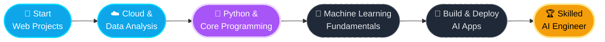

  

 

## 👨‍💻 &nbsp;About Me

Hey there! I'm **Muneeb Fayaz**, a developer passionate about technology, problem-solving, and building things that make a difference.

| | |
|---|---|
| 💻 | Working with **full stack web development** |
| ☁️ | Exploring **cloud computing & AWS** |
| 📊 | Extracting meaningful insights from **data** |
| 🤖 | Currently transitioning towards **AI Engineering** |
| 🧠 | Strengthening **Python, ML & AI fundamentals** |
| 🚀 | Focused on practical projects & consistent learning |

> 💡 *I don't just want to use technology — I want to understand it, build with it, and create something meaningful.*

## ⚡ &nbsp;My Tech Universe

| 🌐 Web Development | ☁️ Cloud & Databases | 📊 Data & Tools |
|:---:|:---:|:---:|
|  |  |  |

### 🤖 My Next Frontier: AI Engineering

*Combining software development, cloud, and AI to build intelligent real-world applications.*

## 🚀 &nbsp;Projects I'm Proud Of

<table>
<tr>
<td width="50%" valign="top">

### 🌾 Kashmir Kisan Saathi
A farmer-focused platform connecting farmers with buyers and agricultural services.

`Web Development` `Accessibility` `Digital Agriculture`

</td>
<td width="50%" valign="top">

### 🎮 Gaming Website
A personal gaming site inspired by my passion for gaming and creative web experiences.

`HTML` `CSS` `JavaScript`

</td>
</tr>
<tr>
<td colspan="2" align="center">

### 📈 Data Analysis & AI Projects
*Building my foundation through data analysis, programming exercises and upcoming AI projects — more coming as I grow.* 🌱

</td>
</tr>
</table>

## 📊 &nbsp;GitHub Analytics

### 🔥 Contribution Streak

### 📈 Contribution Graph

### 🏆 Trophies

## 🎯 &nbsp;The Road Ahead

| Step | Milestone | Status |
|:---:|---|:---:|
| **01** | Start building real-world web projects | ✅ Done |
| **02** | Explore cloud technologies & data analysis | ✅ Done |
| **03** | Strengthen Python & core programming skills | 🔄 In Progress |
| **04** | Master machine learning fundamentals | ⏳ Up Next |
| **05** | Build & deploy AI-powered applications | 🎯 Planned |
| **06** | Grow into a skilled AI Engineer | 🏆 Ultimate Goal |

## 🤝 &nbsp;Let's Build Something Great

Have an idea, a project to collaborate on, or an opportunity to discuss?
**Let's connect and create something meaningful.**

### `BUILD • LEARN • INNOVATE`

Always learning. Always building. Always moving forward.

