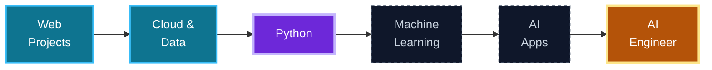

<!-- =========================================================
     MUNEEB FAYAZ | GITHUB PROFILE README
     Theme: Midnight Navy / Cyan / Violet accent
     Self-contained: no /assets folder needed
========================================================== -->

  

  

  

    
    
    
    
  

  

    
    &nbsp;
    
  

## About Me

I'm a developer who likes to understand how things work, then build with them. I work on full stack web projects, I'm exploring cloud computing with AWS, and I'm moving step by step towards **AI Engineering** by strengthening my Python, machine learning and AI fundamentals.

| | |
|:--|:--|
| **Focus** | Full stack web development |
| **Exploring** | Cloud computing and AWS |
| **Interests** | Data analysis, machine learning, building useful products |
| **Approach** | Practical projects, consistent learning, continuous improvement |
| **Current focus** | Python, machine learning and AI fundamentals |

> *I don't just want to use technology. I want to understand it, build with it, and create something meaningful.*

## Learning Journey

| Covered so far | Practising now |
|:--|:--|
| Full stack web development basics | Python fundamentals and core programming |
| Frontend with HTML, CSS, JavaScript and React | Data analysis with NumPy and Pandas |
| Backend with Node.js and Express | Machine learning concepts |
| Databases: MySQL, MongoDB and Firebase | Problem-solving and cleaner code |
| Two live projects deployed on Netlify | Preparing for AI-powered projects |

<b>See the full roadmap</b>

 

| Stage | Learning Area | Status |
|:--|:--|:--|
| 01 | Real-world web projects | Completed |
| 02 | Cloud technologies and data analysis | Completed |
| 03 | Python and core programming skills | **In progress** |
| 04 | Machine learning fundamentals | Up next |
| 05 | Build and deploy AI-powered applications | Planned |
| 06 | Grow into a skilled AI Engineer | Long-term goal |

## Tech Stack

<table>
  <tr>
    <td align="center" width="33%">
      <b>Web development</b>  
        
      HTML · CSS · JavaScript React · Node.js · Express
    </td>
    <td align="center" width="33%">
      <b>Cloud and databases</b>  
        
      AWS · Firebase MySQL · MongoDB
    </td>
    <td align="center" width="33%">
      <b>Data and tools</b>  
        
      Python · NumPy · Pandas Git · GitHub · VS Code
    </td>
  </tr>
</table>

 

**My next frontier: AI Engineering**

## Selected Work

<table>
  <tr>
    <td align="center" valign="top" width="50%">
      <h3>Kashmir Kisan Saathi</h3>
      A farmer-focused platform connecting farmers with buyers and agricultural services.  
      
      
        
      
    </td>
    <td align="center" valign="top" width="50%">
      <h3>Gaming Website</h3>
      A personal gaming site inspired by my passion for gaming and creative web experiences.  
      
      
        
      
    </td>
  </tr>
  <tr>
    <td align="center" colspan="2">
      <b>Next up:</b> data analysis and AI projects, built as I learn. More coming soon.
    </td>
  </tr>
</table>

 

## Goals

| Short-term | Long-term |
|:--|:--|
| Strengthen Python and core programming skills | Grow into a skilled AI Engineer |
| Master machine learning fundamentals | Build and deploy AI-powered applications |
| Keep building and publishing projects | Combine software, cloud and AI in real-world products |
| Turn data analysis into real projects | Build intelligent applications independently |

## GitHub Activity

Cards refresh on their own schedule, so new activity can take a few hours to appear.

  

  

## Connect With Me

  I'm always interested in learning, building useful things, and meeting people who enjoy technology.

&nbsp;

  

### Build. Learn. Innovate. Always moving forward.

