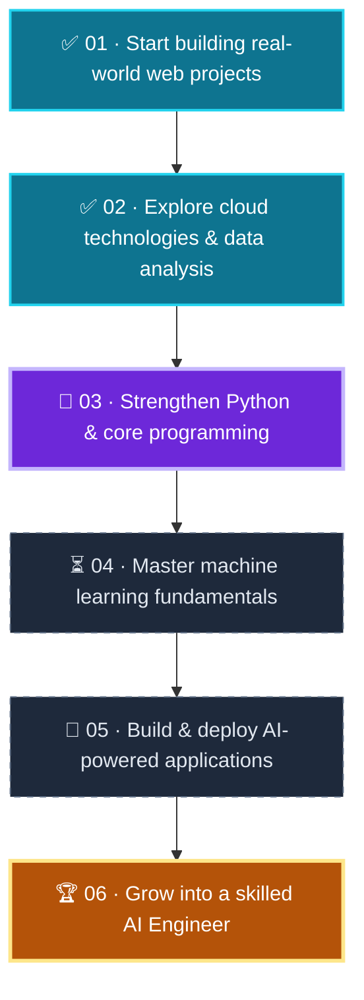

 

  

 

Hey there! I'm **Muneeb Fayaz**, a developer passionate about technology, problem-solving
and building things that make a difference.

 

<table width="100%">
<tr>
<td align="center" width="33%"><h3>💻</h3><b>Full Stack Web</b> Building complete web apps</td>
<td align="center" width="33%"><h3>☁️</h3><b>Cloud &amp; AWS</b> Exploring cloud computing</td>
<td align="center" width="33%"><h3>📊</h3><b>Data Analysis</b> Insights from real data</td>
</tr>
<tr>
<td align="center" width="33%"><h3>🤖</h3><b>AI Engineering</b> My current transition</td>
<td align="center" width="33%"><h3>🧠</h3><b>Python &amp; ML</b> Strengthening fundamentals</td>
<td align="center" width="33%"><h3>🚀</h3><b>Practical Projects</b> Consistent learning</td>
</tr>
</table>

 

<i>💡 I don't just want to use technology — I want to understand it, build with it, and create something meaningful.</i>

 

<table width="100%">
<tr>
<th width="33%">🌐 Web Development</th>
<th width="33%">☁️ Cloud &amp; Databases</th>
<th width="33%">📊 Data &amp; Tools</th>
</tr>
<tr>
<td align="center"></td>
<td align="center"></td>
<td align="center"></td>
</tr>
</table>

 

**🤖 My next frontier: AI Engineering**

Combining software development, cloud and AI to build intelligent real-world applications.

 

<table width="100%">
<tr>
<td width="50%" valign="top" align="center">

<h3>🌾 Kashmir Kisan Saathi</h3>

A farmer-focused platform connecting farmers with buyers and agricultural services.

  

</td>
<td width="50%" valign="top" align="center">

<h3>🎮 Gaming Website</h3>

A personal gaming site inspired by my passion for gaming and creative web experiences.

  

</td>
</tr>
<tr>
<td colspan="2" align="center">

📈 <b>Data Analysis &amp; AI Projects</b> — building my foundation now, more experiments coming as I grow 🌱

</td>
</tr>
</table>

 

  

 

 

<table width="100%">
<tr><th width="10%">Step</th><th>Milestone</th><th width="22%">Status</th></tr>
<tr><td align="center"><b>01</b></td><td>Start building real-world web projects</td><td align="center"></td></tr>
<tr><td align="center"><b>02</b></td><td>Explore cloud technologies &amp; data analysis</td><td align="center"></td></tr>
<tr><td align="center"><b>03</b></td><td>Strengthen Python &amp; core programming</td><td align="center"></td></tr>
<tr><td align="center"><b>04</b></td><td>Master machine learning fundamentals</td><td align="center"></td></tr>
<tr><td align="center"><b>05</b></td><td>Build &amp; deploy AI-powered applications</td><td align="center"></td></tr>
<tr><td align="center"><b>06</b></td><td>Grow into a skilled AI Engineer</td><td align="center"></td></tr>
</table>

 

Have an idea, a project to collaborate on, or an opportunity to discuss?
**Let's connect and create something meaningful.**

 

